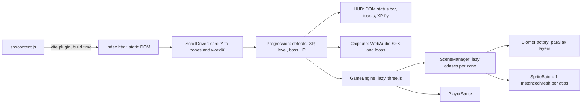

# RYAN.DEV — the résumé is the game

A single-page résumé built as an 8-bit NES side-scroller. Scrolling the page walks the hero through
**Title → Forest (About) → Mountain Cave (Skills) → Castle (Experience & Projects) → Boss Room (Contact)**.
Every career milestone is an enemy; passing it defeats it, XP flies into the HUD, and each new biome levels the hero up
(LV 1 → LV 6: wooden sword → iron → steel armor → red cape → golden armor and crown).

- **Native scrolling.** No scroll-jacking: `scrollY` is read once per frame and mapped onto the world.
- **Content is real DOM.** All text is static HTML rendered at build time from `src/content.js`. The canvas is decoration (`aria-hidden`).
- **three.js `WebGPURenderer` + TSL.** WebGPU when available, automatic WebGL2 backend otherwise, CSS backdrops if neither works.
- **Tiny.** First load ≈ 28 KB. The engine chunk (≈ 224 KB gzipped) loads on the visitor's first interaction. Atlases are 0.6–1.6 KB PNG-8s.

## Quick start

```bash
npm ci
npm run dev        # http://localhost:5173 (content.js edits hot-reload)
npm run build      # static site → dist/
npm run preview    # serve dist/ at http://localhost:4173
```

Requires Node 20+.

| URL flag | Effect |
|---|---|
| `?webgl` | Force the WebGL2 backend (test the Safari/Firefox path in Chrome) |
| `?debug` | Expose the engine as `window.__game` |

## Editing your content

Everything a recruiter reads lives in **`src/content.js`**: profile, summary, skills, jobs, projects, contact, and CTA
buttons. The build renders it into `index.html`, so it is crawlable and works with JavaScript disabled.

To make an item an enemy, give it an `enemy`:

```js
{ text: 'Reduced server CPU utilization from 99% to 30% …', enemy: { kind: 'darkknight', xp: 250, label: 'Server CPU 99% → 30%' } }
```

| Biome (section) | Allowed `kind` |
|---|---|
| Forest (`ABOUT`) | `slime`, `mushroom` |
| Mountain cave (`SKILLS`) | `bat` (easy), `golem`, `dragon` (hardest) |
| Castle (`EXPERIENCE`, `PROJECTS`) | `knight`, `darkknight`, `spikes` (an obstacle the hero jumps) |
| Boss room (`CONTACT`) | `boss` |

An enemy is defeated when its DOM element scrolls to 62% of the viewport height, so the battle happens as its text appears.
The résumé PDF lives in `public/`; keep `PROFILE.resumePdf` in sync with the filename.

## How it works



| Module | Role |
|---|---|
| `src/game/ScrollDriver.js` | Groups `[data-biome]` sections into zones. `worldX = scrollY × 0.5`. Re-measures on resize, font load, and content changes. |
| `src/game/Progression.js` | Game rules with no rendering: trigger points, defeat/revive events, level, XP, boss HP. Works without a GPU. |
| `src/game/HUD.js` | NES status bar (LV, HP/XP bars that grow with level, KO counter, zone name), defeat toast, level-up banner, XP particles. |
| `src/game/GameEngine.js` | Renderer lifecycle: WebGPU/WebGL2 detection, integer-scaled low-res buffer, frame loop, pause/idle, context-loss rebuild. |
| `src/game/SceneManager.js` | Loads a biome atlas when its section is within 1.5 screens (IntersectionObserver) and disposes it beyond 4 screens. Draws enemies and death animations. |
| `src/game/BiomeFactory.js` | Declarative biome definitions (sky bands, parallax tiles, scattered props, gates) and a generic clipped painter. |
| `src/game/PlayerSprite.js` | Hero pose from distance walked, attack, jumps, level-up flash and sparkles. |
| `src/game/AssetLoader.js` | Ref-counted atlas loading and disposal. Nearest-filtered textures. |
| `src/game/SpriteBatch.js` | TSL `MeshBasicNodeMaterial` with per-instance atlas rect and effects (flash, alpha, mirror). One draw call per atlas. |
| `src/game/Chiptune.js` | Pulse, triangle, and noise synth with per-biome loops and SFX. 0 bytes of audio files. |

### Rendering budget

- **Low-res buffer.** The game renders at about 480×270 (≈ 200 px wide in portrait). The canvas is CSS-upscaled by an
  integer factor with `image-rendering: pixelated`. `setPixelRatio(1)` and an 8-bit output buffer
  (`outputBufferType: UnsignedByteType`) keep GPU memory in the low single-digit MB.
- **Draw calls.** Typically 2–3 per frame: the core atlas plus the one or two biomes on screen. Every sprite is an instance.
- **Frame loop.**
  - Runs at full rate only while scrolling or animating, then drops to 8 fps for ambient effects (torches, stars).
  - Stops entirely while the tab is hidden.
  - Never runs under `prefers-reduced-motion`: one static tableau is drawn per zone, and there are no XP particles or flashes.
- **Context loss.** On WebGPU `device.lost` or `webglcontextlost`, the engine builds a fresh renderer and canvas. It reuses the
  scene, atlases, and game state; the page does not reload.

## Swapping in your own art

Atlases are generated from code in `art/` (ASCII sprites plus small procedural helpers) by `npm run atlases`, which
writes `src/assets/atlases/<atlas>.png` (indexed PNG-8 using only NES colours) and `manifest.json`
(frame rectangles). `npm run atlases:preview` also writes 4× previews to `atlas-preview/`.

There are two ways to replace art:

1. **Edit the sources.** Change the ASCII rows in `art/core.mjs` (hero) or `art/biomes.mjs` (biomes and enemies), then run `npm run atlases`.
2. **Bring your own PNGs.** Draw a sheet in any editor, export a PNG, put it at `src/assets/atlases/<atlas>.png`, and
   update that atlas's `frames` in `manifest.json` (`"name": [x, y, w, h]`, top-left origin). Note that `npm run atlases`
   regenerates every atlas from `art/` and overwrites hand-made PNGs.

Frame-name contract (sizes are free; feet sit on the bottom row):

| Atlas | Required frames |
|---|---|
| `core` | `hero_{1..6}_{idle,walk1,walk2,attack}` (40×28, body 16 px wide starting at x=10, facing right), `poof_{0,1,2}`, `spark`, `shadow`, `px_30` |
| `title` | `star_0/1`, `moon`, `castle`, `hills`, `ground_top`, `ground_fill`, sky swatches `px_0f px_02 px_0c` |
| `forest` | `slime_0/1`, `mushroom_0/1`, `cloud`, `cloud_s`, `hills`, `pine`, `tree`, `bush`, `flower_0/1`, `gate`, `ground_top`, `ground_fill`, `px_21 px_31` |
| `mountain` | `bat_0/1`, `golem_0/1`, `dragon_0/1`, `peaks`, `spires`, `stalactite`, `stalactite_s`, `crystal_0/1`, `rock`, `gate`, `ground_top`, `ground_fill`, `px_0f px_0c px_1c` |
| `castle` | `knight_0/1`, `darkknight_0/1`, `spikes_0/1`, `wall`, `window`, `banner`, `torch_0/1`, `gate`, `ground_top`, `ground_fill`, `px_0f` |
| `boss` | `boss_0/1` (drawn at 2×), `wall`, `pillar`, `brazier_0/1`, `gate`, `ground_top`, `ground_fill`, `px_0f` |

- `px_XX` frames are 4×4 solid swatches named by NES palette index and stretched for sky bands.
- `ground_*` tiles are 16×16.
- Enemies face left.
- Layer placement (parallax factor, density, height) is defined in `src/game/BiomeFactory.js`.

### Palette

All art and CSS colours come from the NES 2C02 master palette in `src/game/palette.js`: 64 slots, 54 unique colours.
Sprites in `art/` reference palette indices, so the generated atlases cannot contain any other colour. If you draw PNGs by hand,
stick to these hex values.

| | x0 | x1 | x2 | x3 | x4 | x5 | x6 | x7 | x8 | x9 | xA | xB | xC | xD |
|---|---|---|---|---|---|---|---|---|---|---|---|---|---|---|
| 0x | 7c7c7c | 0000fc | 0000bc | 4428bc | 940084 | a80020 | a81000 | 881400 | 503000 | 007800 | 006800 | 005800 | 004058 | 000000 |
| 1x | bcbcbc | 0078f8 | 0058f8 | 6844fc | d800cc | e40058 | f83800 | e45c10 | ac7c00 | 00b800 | 00a800 | 00a844 | 008888 | — |
| 2x | f8f8f8 | 3cbcfc | 6888fc | 9878f8 | f878f8 | f85898 | f87858 | fca044 | f8b800 | b8f818 | 58d854 | 58f898 | 00e8d8 | 787878 |
| 3x | fcfcfc | a4e4fc | b8b8f8 | d8b8f8 | f8b8f8 | f8a4c0 | f0d0b0 | fce0a8 | f8d878 | d8f878 | b8f8b8 | b8f8d8 | 00fcfc | f8d8f8 |

(xE/xF are black and omitted.)

## Deploying to GitHub Pages

1. Push to `main`.
2. In the repo, open **Settings → Pages → Build and deployment → Source** and choose **GitHub Actions**.
3. `.github/workflows/deploy.yml` runs `npm ci && npm run build` and publishes `dist/`.
4. Update `SITE.url` in `src/content.js` (used for the canonical and OpenGraph URLs).

The build uses relative asset paths (`base: './'`), so it works from any sub-path such as `user.github.io/repo/`.
`public/.nojekyll` and `public/robots.txt` are copied into the build as-is.

## Acceptance checks

Measured on a production build served by `npm run preview` with Lighthouse 12 and headless Chrome:

| Check | Target | Result |
|---|---|---|
| Lighthouse mobile: Perf / A11y / Best practices / SEO | ≥ 90 / ≥ 95 / – / ≥ 95 | 98 / 100 / 100 / 100 (LCP 1.0 s, TBT 60 ms, CLS 0.095) |
| Lighthouse desktop | same | 100 / 100 / 100 / 100 |
| JS bundle (gzip) | < 300 KB | 5.3 KB entry + 224 KB engine, loaded lazily |
| Page weight | < 2 MB | 28 KB first load; ≈ 260 KB with engine, font, and atlases |
| Long tasks > 100 ms while scrolling the full page | 0 | 0 (PerformanceObserver `longtask`) |
| JS heap after scrolling top → bottom → top | – | ≈ 21 MB; at most 3 biome atlases resident |
| WebGPU (Chrome) | renders | ✓ `data-renderer="webgpu"` |
| WebGL2 fallback | renders | ✓ with `?webgl` (the same backend path Safari and Firefox take without WebGPU) |
| Context loss | recovers without reload | ✓ `WEBGL_lose_context`: renderer and canvas rebuilt, game state kept |
| `prefers-reduced-motion` | static | ✓ no rAF loop, one static frame per zone |

Not yet verified on real Safari, Firefox, or a physical mid-tier phone; re-run these checks there before relying on them.
The `<html data-renderer>` attribute shows which backend is active (`webgpu`, `webgl2`, or `none`).
